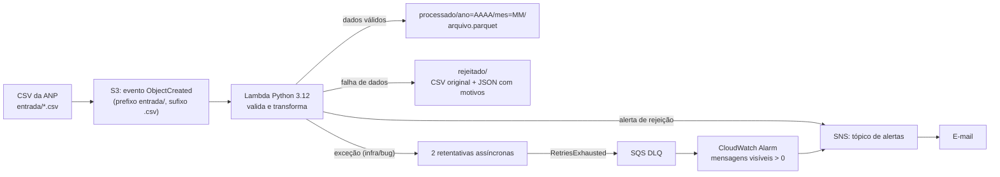
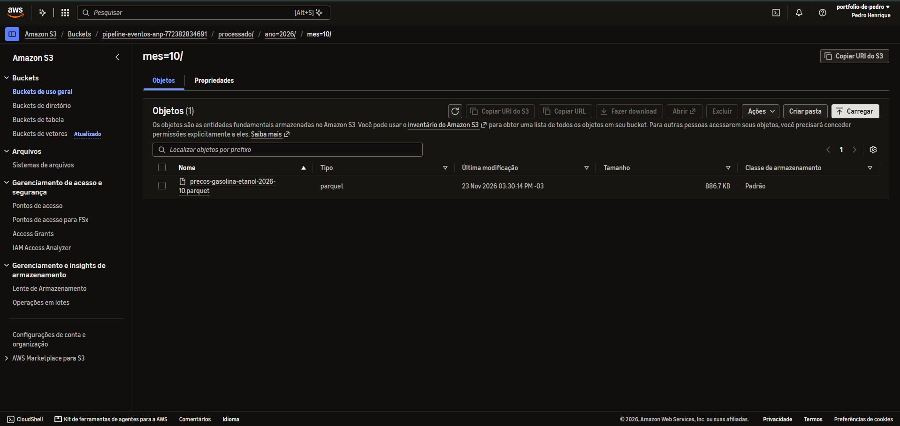
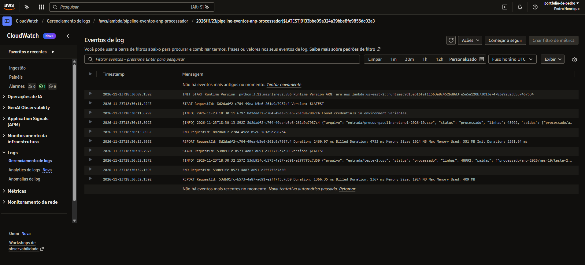
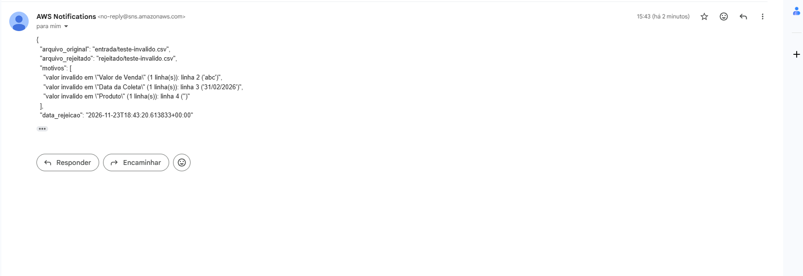
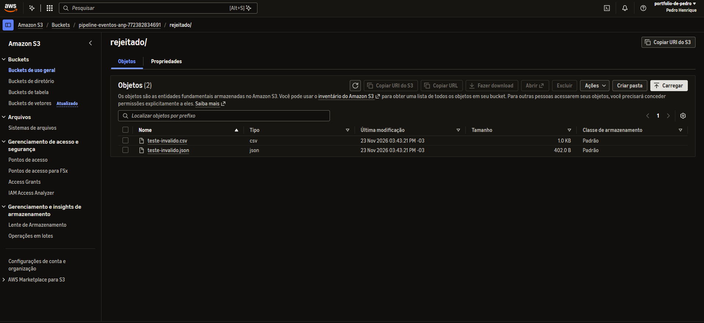
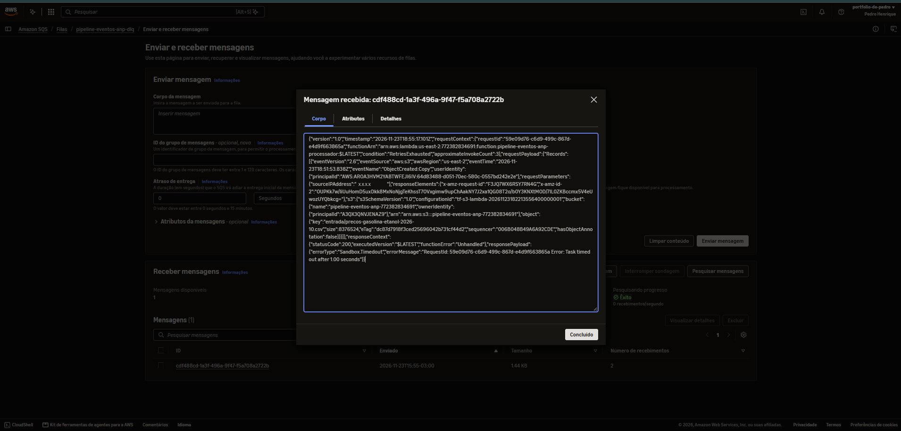
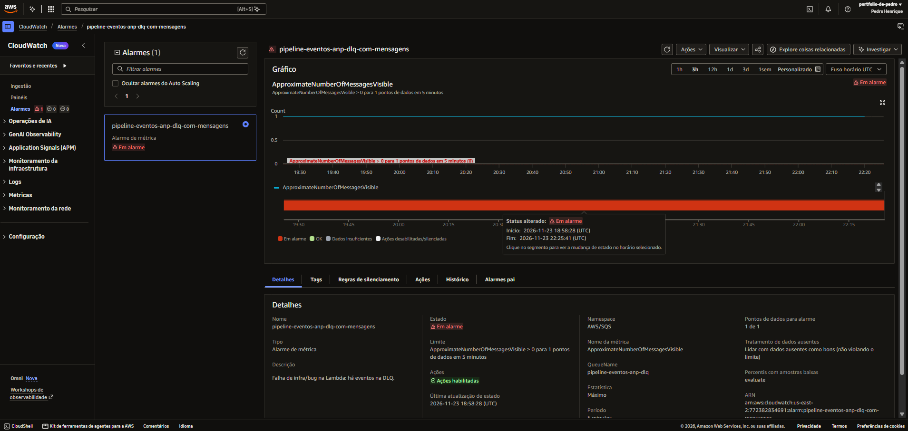
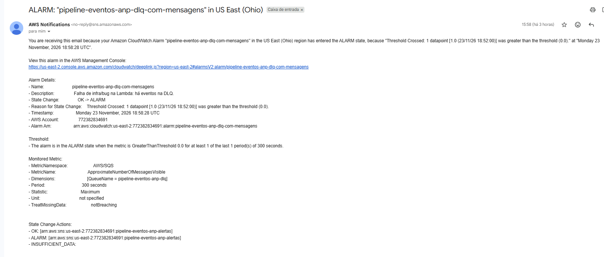
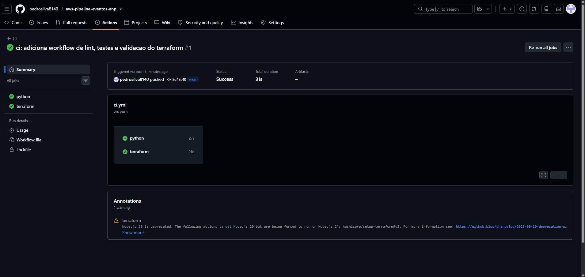

# Pipeline orientado a eventos na AWS: preços de combustíveis da ANP

[](https://github.com/pedrosilva8140/aws-pipeline-eventos-anp/actions/workflows/ci.yml)

Quando um CSV de preços de combustíveis da ANP chega ao S3, uma Lambda em Python valida o arquivo, transforma os dados e grava Parquet particionado por ano e mês. Arquivos com problema de dados são separados com o motivo e geram um alerta. Falhas de infraestrutura passam por retentativas, caem numa DLQ e disparam um alarme por e-mail.

**Stack:** Python 3.12 · pandas · PyArrow · AWS Lambda · S3 · SNS · SQS · CloudWatch · IAM · Terraform · GitHub Actions · pytest · ruff

**Destaques**
- **48.992 linhas processadas em 1,4 s** (Lambda aquecida). O CSV de 8,4 MB virou um Parquet de 0,9 MB.
- **3 caminhos testados na AWS:** sucesso, arquivo inválido e falha de infraestrutura com DLQ e alarme.
- **Infraestrutura 100% em Terraform e custo zero:** só serviços dentro do free tier, sem VPC, NAT, KMS próprio ou Glue.
- **53 testes automatizados e CI** com lint, testes e validação do Terraform a cada push.

> A infraestrutura foi destruída depois dos testes (custo zero). Os prints abaixo são a evidência da execução.

---

## Arquitetura



O mesmo bucket guarda quatro prefixos:

| Prefixo | Quem grava | Conteúdo |
|---|---|---|
| `entrada/` | usuário | CSV original. É o único prefixo que dispara a Lambda. |
| `processado/` | Lambda | Parquet particionado em `ano=AAAA/mes=MM/` |
| `rejeitado/` | Lambda | CSV rejeitado e `<nome>.json` com os motivos |
| `artefatos/` | Terraform | Pacote `.zip` da Lambda |

## Decisões de projeto

- **Falha de dados e falha de infraestrutura têm tratamentos diferentes.**
  - Um arquivo com schema errado, valor inválido ou sem linhas é um problema do arquivo, e tentar de novo não resolve. Nesse caso a Lambda **não lança exceção**: move o CSV para `rejeitado/`, grava um JSON com os motivos e publica no SNS.
  - Já um erro de S3, de SNS ou de código lança exceção. A Lambda tenta de novo 2 vezes e, se ainda falhar, o evento vai para a DLQ.
- **Motivos de rejeição acionáveis.** Cada motivo diz a coluna, quantas linhas falharam e até 5 exemplos com o número da linha no arquivo, por exemplo: `valor invalido em "Data da Coleta" (1 linha(s)): linha 3 ('31/02/2026')`.
- **Sem loop de eventos.** A Lambda nunca grava em `entrada/`, e a política IAM só permite `PutObject` em `processado/*` e `rejeitado/*`.
- **Idempotência.**
  - O nome do Parquet vem do nome do CSV, então reprocessar o mesmo arquivo sobrescreve a saída em vez de duplicar.
  - Na rejeição, o arquivo só sai de `entrada/` **depois** do alerta no SNS. Se algo falhar no meio, a retentativa refaz tudo.
  - Se o arquivo já não existir (`NoSuchKey`), a retentativa é tratada como "já processado".
- **Permissões mínimas por prefixo.** A Lambda só lê e apaga em `entrada/*`.
  - O `s3:ListBucket` também ficou restrito a `entrada/`. Sem essa permissão, o S3 responde `AccessDenied` em vez de `NoSuchKey`, e a idempotência acima deixaria de funcionar.
- **Pacote sem layer.**
  - pandas, numpy e pyarrow vão dentro do zip, montado com wheels Linux x86_64 / Python 3.12.
  - O pacote tem 232 MB descompactado (o limite da Lambda é 250 MB) e 74 MB zipado. Por isso o deploy é feito a partir do S3.
  - O script de empacotamento falha acima de 245 MB e gera um zip reproduzível: o mesmo conteúdo dá o mesmo hash, então o Terraform só reenvia o pacote quando algo muda.
  - As dependências transitivas têm versão fixa. O `python-dateutil` fica abaixo da versão 3, porque o pacote vem antes do runtime no `sys.path` e uma versão nova quebraria o botocore.
- **Região us-east-2.** A conta é um projeto da nova experiência de cadastro da AWS (*projects*), com região do projeto us-east-2. A AWS aplica a esses projetos uma SCP gerenciada, que não pode ser editada e nega quase tudo em us-east-1. Por isso a região é uma variável do Terraform, com padrão us-east-2.
- **Custo zero e segurança.**
  - Logs com retenção de 7 dias.
  - Criptografia gerenciada (SSE-S3 e SSE do SQS), sem chave KMS própria.
  - Bloqueio de acesso público no bucket.
  - `force_destroy` no bucket para o `terraform destroy` limpar tudo.

## Testes ponta a ponta na AWS

Os três testes foram executados em 23/11/2026, em us-east-2, com o arquivo de outubro de 2026 da ANP (gasolina e etanol).

### 1. Caminho feliz

O upload do CSV em `entrada/` gera o Parquet em `processado/ano=2026/mes=10/`.

| Métrica | Valor |
|---|---|
| Linhas | 48.992 |
| Duração (Lambda aquecida) | 1,4 s |
| Inicialização no cold start (`Init Duration`) | +2,3 s |
| Pico de memória | 409 MB (de 1024 MB) |
| Tamanho | CSV de 8,4 MB → Parquet de 0,9 MB (Snappy) |





### 2. Arquivo com dados inválidos

O teste usou um CSV com valor de venda não numérico, uma data inexistente (`31/02/2026`) e um produto vazio. A Lambda terminou sem erro: moveu o arquivo para `rejeitado/`, gravou o JSON com os três motivos e enviou o alerta por e-mail. O arquivo saiu de `entrada/` e a DLQ continuou vazia, como esperado para uma falha de dados.





### 3. Falha de infraestrutura (DLQ e alarme)

**Como a falha foi provocada.** O timeout da Lambda foi reduzido para 1 s com `terraform plan -var timeout_lambda_segundos=1`. Depois, o CSV válido foi reprocessado.

**O que aconteceu:**
- A Lambda tentou 3 vezes, todas com o mesmo `RequestId` e todas terminando em timeout: a invocação original, uma retentativa cerca de 1 min depois e outra cerca de 2 min depois.
- Esgotadas as tentativas, a mensagem `on_failure` chegou à DLQ com:
  - `condition: RetriesExhausted`;
  - `approximateInvokeCount: 3`;
  - a chave do arquivo;
  - o erro `Sandbox.Timedout`.
- Do upload ao alarme em `ALARM` e ao e-mail foram cerca de 7,5 min: cerca de 4 min de retentativas e cerca de 3,5 min até a métrica da SQS ser publicada e avaliada (período de 5 min).

**Recuperação:**
1. O timeout voltou para 120 s com um novo `terraform plan` / `apply`, com uma única mudança.
2. O arquivo foi reprocessado sem reenvio do disco, copiando o objeto sobre ele mesmo:
   ```
   aws s3 cp s3://<bucket>/entrada/<arquivo>.csv s3://<bucket>/entrada/<arquivo>.csv --metadata-directive REPLACE --region us-east-2
   ```
3. O status foi `processado`, e o Parquet foi sobrescrito sem duplicar: continuou existindo um único arquivo na partição.
4. Depois do purge da DLQ, o alarme voltou para `OK` em cerca de 8 min.







## Problemas encontrados e lições

- **SCP gerenciada bloqueando us-east-1.**
  - Na primeira tentativa de deploy em us-east-1, o `lambda:GetLayerVersion` e depois a criação do bucket, do tópico e da fila falharam com `explicit deny`.
  - A conta é um projeto da experiência *projects* da AWS, com região do projeto us-east-2. Para esses projetos, a AWS aplica uma SCP gerenciada, que não pode ser editada e nega quase tudo em us-east-1 (Sid `UsEast1Partitional`).
  - O diagnóstico juntou três fontes: o ARN da SCP na mensagem de erro, a documentação pública das políticas gerenciadas para projetos e a região do projeto no AWS Settings.
  - A solução foi usar us-east-2, como variável do Terraform.
  - Lição: um `explicit deny` de SCP não se resolve com IAM. Primeiro descubra de onde vem a política e se ela é gerenciada, antes de tentar contornar.
- **O `pandas.read_csv` desloca colunas sem avisar.**
  - Quando uma linha tem mais campos que o cabeçalho, o pandas usa os campos excedentes como índice e desloca as colunas.
  - A leitura passou a usar o módulo `csv` da biblioteca padrão, que respeita aspas (640 linhas do arquivo real têm `;` dentro de campos), e a rejeitar o arquivo com a linha exata do problema.
- **Wheels do numpy.** O numpy 2.3 em diante só publica wheels `manylinux_2_28`. O empacotamento aceita as duas plataformas (`manylinux2014` e `manylinux_2_28`), que o runtime python3.12 da Lambda suporta.
- **Dependência transitiva quebrando o runtime.** Sem versão fixa, o pip instalava `python-dateutil` 4.x, que vem antes do runtime no `sys.path` e quebraria o botocore. Agora todas as dependências, inclusive as transitivas, estão no `requirements.txt` com versão fixa.
- **Zip não reproduzível.** Os executáveis de `bin/` e os arquivos `RECORD` mudavam a cada build, e o Terraform reenviava o pacote sem necessidade. Os dois foram removidos, e as datas e a ordem dos arquivos no zip passaram a ser fixas.
- **Primeiro evento perdido.**
  - O primeiro upload, cerca de 2,5 min depois de criar a notificação do bucket, não disparou a Lambda.
  - Não houve log nem métrica, e a DLQ ficou vazia.
  - Um segundo upload, minutos depois, funcionou em cerca de 2 s.
  - A causa provável é a propagação de uma notificação recém-criada. O comando `cp --metadata-directive REPLACE` reprocessa o arquivo sem reenviá-lo.
- **Idempotência por nome não basta.** No teste, o mesmo conteúdo enviado com outro nome gerou um segundo Parquet na mesma partição (ver limitações).

## Dados de entrada e saída

**Fonte:** [Série Histórica de Preços de Combustíveis da ANP](https://www.gov.br/anp/pt-br/centrais-de-conteudo/dados-abertos/serie-historica-de-precos-de-combustiveis). Os testes usam pequenos recortes do arquivo real em `tests/fixtures/`.

**Particularidades do CSV, tratadas na leitura:**
- O arquivo vem em UTF-8 com BOM e fim de linha CRLF. Arquivos antigos podem vir em Latin-1, então a leitura tenta `utf-8-sig` e, se falhar, `latin-1`.
- O separador é `;`, e há `;` dentro de campos entre aspas. Por isso a leitura usa um parser CSV de verdade, nunca `split`.
- O decimal usa vírgula (`6,89`) e as datas vêm em `dd/mm/aaaa`.
- O `CNPJ da Revenda` vem formatado e com um espaço no início, e o `Valor de Compra` vem vazio.
- São 16 colunas com nome fixo. O layout pode mudar entre períodos, então o schema é validado (colunas ausentes ou inesperadas).

**Validação:** o schema é conferido primeiro. Se estiver certo, cada linha precisa ter `Valor de Venda` numérico e maior que zero, `Data da Coleta` válida e `Produto` preenchido.

**Saída (Parquet com compressão Snappy):**

| Coluna | Tipo | Observação |
|---|---|---|
| `regiao`, `uf`, `municipio`, `revenda`, `bairro`, `cep`, `produto`, `bandeira`... | string | Nomes em snake_case |
| `cnpj` | string | Só os dígitos |
| `data_coleta` | date32 | |
| `valor_venda`, `valor_compra` | float64 | Vazio vira nulo |

O arquivo de saída é `processado/ano=AAAA/mes=MM/<nome-do-csv>.parquet`. Se um CSV tiver datas de mais de um mês, a Lambda grava um Parquet em cada partição.

## CI

O [workflow](.github/workflows/ci.yml) roda a cada push na `main` e em pull requests, com `permissions: contents: read` e **sem credenciais AWS**:

- **python:** `ruff check`, `ruff format --check` e `pytest` (53 testes).
- **terraform:** `terraform fmt -check`, depois o empacotamento da Lambda (que garante o limite de 245 MB e gera o zip exigido pelo `validate`), `terraform init -backend=false` e `terraform validate`.



## Limitações e próximos passos

- **A idempotência é por nome de arquivo.** O mesmo conteúdo enviado com outro nome duplica os dados na partição. Próximo passo: derivar a chave de saída de um hash do conteúdo, ou recusar arquivos cujo hash já foi processado.
- **O arquivo inteiro fica em memória.** Um CSV de 8,4 MB chegou a 409 MB de pico, o que dá um limite prático de tamanho. Para arquivos bem maiores, as alternativas são ler e gravar em blocos, ou mover o processamento para Glue ou ECS.
- **A validação é tudo ou nada, por escolha.** Uma única linha inválida rejeita o arquivo inteiro, para não publicar dados parciais sem ninguém perceber. Alternativa: separar só as linhas inválidas num arquivo de quarentena e processar o restante.
- **O CSV válido continua em `entrada/`** depois de processado. Uma regra de ciclo de vida do S3 poderia expirar esses arquivos ou movê-los para uma classe mais barata.
- **Não há catálogo nem consulta.** Um próximo passo é registrar `processado/` num catálogo (Glue Data Catalog) e consultar com Athena.
- **O alarme é lento.** A métrica da SQS tem granularidade de 5 min, e o alerta de falha de infraestrutura leva cerca de 7 min para chegar.

## Estrutura do repositório

```
.github/workflows/ci.yml    lint, testes e validação do Terraform
src/processador/
  handler.py                orquestração: evento, S3, SNS (sem regra de negócio)
  validacao.py              leitura do CSV e validação (funções puras)
  transformacao.py          tipos, snake_case, partição e Parquet (funções puras)
tests/                      pytest (S3 e SNS falsos em memória) e fixtures/
infra/                      Terraform: S3, Lambda, IAM, SNS, SQS, alarme
scripts/
  empacotar.py              gera infra/build/lambda.zip (wheels Linux, zip reproduzível)
  recortar_amostra.py       gera as fixtures a partir do arquivo real
docs/img/                   prints dos testes
```

## Como rodar localmente

Pré-requisito: Python 3.12. Os comandos abaixo são do PowerShell (Windows).

```powershell
py -3.12 -m venv .venv
.\.venv\Scripts\Activate.ps1
pip install -r requirements-dev.txt

ruff check . ; ruff format --check .
pytest -v
```

Os testes não acessam a AWS: o `handler` é testado com S3 e SNS falsos em memória.

## Deploy e destruição

Pré-requisitos: Terraform 1.17 ou mais novo, AWS CLI autenticado e Python 3.12.

```powershell
python scripts/empacotar.py                     # gera infra/build/lambda.zip

cd infra
Copy-Item terraform.tfvars.example terraform.tfvars   # preencha email_alertas (fora do git)
terraform init
terraform plan -out=tfplan
terraform apply tfplan
```

Depois do apply, faça o seguinte:
1. Confirme a inscrição no link que a AWS envia por e-mail. Sem isso, os alertas não chegam.
2. Dispare o pipeline com um upload (o comando de exemplo também está em `terraform output comando_upload_exemplo`):
   ```powershell
   aws s3 cp <arquivo>.csv s3://<bucket>/entrada/ --region us-east-2
   ```
   Se o primeiro upload logo depois do apply não disparar a Lambda, espere alguns minutos pela propagação da notificação e reprocesse com `cp --metadata-directive REPLACE`.

Para destruir tudo (o bucket é esvaziado automaticamente):

```powershell
cd infra
terraform destroy
```

## Outros projetos do portfólio

- [aws-lakehouse-bcb](https://github.com/pedrosilva8140/aws-lakehouse-bcb): lakehouse na AWS com dados do Banco Central.
- [gcp-dw-cota-parlamentar](https://github.com/pedrosilva8140/gcp-dw-cota-parlamentar): data warehouse no GCP com dbt, sobre a cota parlamentar.
